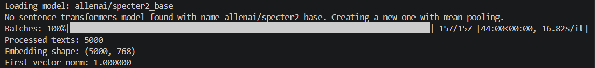

## Part 1 — Data Preparation and Embeddings

### 1.1 Dataset Preparation

The project uses a reproducible sample of 5,000 scientific papers from the [arXiv Dataset](https://www.kaggle.com/datasets/Cornell-University/arxiv). Reservoir sampling (`seed=42`) was applied to avoid selecting only older publications from the beginning of the dataset.

- Valid records scanned: **3,252,452**
- Selected papers: **5,000**
- Unique paper IDs: **5,000**
- Missing abstracts: **0**
- Publication years: **1991–2026**
- Recent `cs.LG` papers (2021+): **197**

The cleaned dataset is saved to `data/arxiv_subset.parquet`.

### 1.2 Tool Selection — Theoretical Questions

#### Q1. How do Pinecone, Qdrant, and Chroma differ?

| Criterion | Pinecone | Qdrant | Chroma |
|---|---|---|---|
| Deployment | Fully managed cloud | Self-hosted or managed cloud | Embedded, self-hosted server, cloud offerings |
| License | Proprietary | Apache 2.0 | Apache 2.0 |
| Main advantage | Minimal infrastructure management | Deployment control, flexible filtering, hybrid search | Simple integration and rapid prototyping |
| Main trade-off | Vendor lock-in and usage costs | Operational overhead when self-hosted | Embedded deployments have scalability limitations |
| Preferred use | Managed production search | Enterprise search requiring infrastructure control | Local RAG experiments and small prototypes |

**My assessment:** I would choose **Pinecone** when fast deployment and minimal infrastructure maintenance are priorities. Its main trade-offs are vendor dependency, usage-based costs, and less low-level control. **Qdrant** would be my choice for enterprise applications requiring flexible metadata filtering, hybrid search, or self-hosted deployment. Its managed cloud option can also reduce operational overhead. **Chroma** is particularly attractive for learning, prototyping, and local RAG development because it can run directly within an application. However, scalability and performance must be evaluated for the selected deployment mode and workload. There is no universal performance winner without comparable benchmarks.

#### Q2. Why SPECTER2 instead of all-MiniLM-L6-v2?

SPECTER2 was designed for **scientific document representations**, making it a domain-specific choice for searching arXiv publications. Its base model was trained on scientific citation relationships and subsequently combined with task-specific adapters trained on SciRepEval tasks.

According to the [official SPECTER2 model card](https://huggingface.co/allenai/specter2_base), the supported training task formats include **Classification, Regression, Proximity (Retrieval), and Adhoc Search**.

In comparison, [all-MiniLM-L6-v2](https://huggingface.co/sentence-transformers/all-MiniLM-L6-v2) is a general-purpose sentence embedding model producing 384-dimensional vectors. It is smaller and typically more computationally efficient, but it is not specifically optimized for scientific publication representations.

SPECTER2 produces 768-dimensional representations and offers domain specialization. However, its actual retrieval quality should be validated experimentally rather than assumed to be better for every query.

**Implementation note:** This assignment uses `allenai/specter2_base` through Sentence Transformers. Since the model does not provide a native Sentence Transformers configuration, the library initializes mean pooling automatically. The official SPECTER2 implementation uses CLS-token representations and supports task-specific adapters. This difference is a limitation of the educational implementation.

#### Q3. Which similarity metric should be used?

The [SPECTER2 model card](https://huggingface.co/allenai/specter2_base) does not explicitly prescribe a single similarity metric. For this project, **cosine similarity** was selected because the embeddings are L2-normalized.

Cosine similarity measures the angle between vectors independently of their magnitude. This is suitable when semantic orientation matters more than vector length.

Selecting the appropriate metric when creating the Pinecone index is important because it determines how vectors are scored and ranked. The metric should be consistent with the embedding model and the intended retrieval behavior.

### 1.3 Embedding Generation

Scientific papers were encoded using the format:

`title + " [SEP] " + abstract`

The embeddings were generated with `allenai/specter2_base`, using batched processing and L2 normalization.

| Metric | Result |
|---|---|
| Papers processed | 5,000 |
| Embedding dimensions | 768 |
| Output shape | `(5000, 768)` |
| First embedding L2 norm | 1.000000 |
| Processing time | Approximately 44 minutes |
| Output file | `embeddings/embeddings.npy` |

**Execution evidence:**

#### Why is cosine similarity equivalent to dot product for normalized embeddings?

Cosine similarity measures the angle between two vectors, while dot product also depends on their magnitudes.

When embeddings are L2-normalized, each vector has a length of 1. Therefore, the cosine similarity formula simplifies to the dot product because the normalization factor equals 1.

As a result, cosine similarity and dot product produce equivalent similarity scores and rankings for normalized embeddings, apart from minor floating-point differences.

**Conclusion:** Normalization makes vector comparisons independent of magnitude and ensures consistent similarity rankings.

This means cosine similarity and dot product produce the same
similarity scores and rankings for unit-length vectors, apart
from minor floating-point differences.

