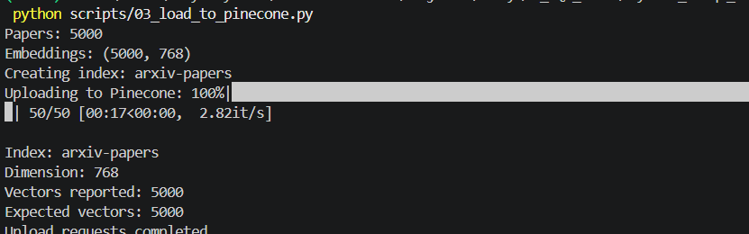

## Part 1 — Data Preparation and Embeddings

### 1.1 Dataset Preparation

A reproducible sample of **5,000 arXiv papers** was selected using reservoir sampling (`seed=42`) from the [arXiv Dataset](https://www.kaggle.com/datasets/Cornell-University/arxiv).

- Valid records scanned: 3,252,452
- Selected papers: 5,000 (all unique, no missing abstracts)
- Publication years: 1991–2026
- Recent `cs.LG` papers (2021+): 197
- Output: `data/arxiv_subset.parquet`

### 1.2 Tool Selection

#### Q1. Pinecone vs Qdrant vs Chroma

| Criterion | Pinecone | Qdrant | Chroma |
|---|---|---|---|
| Deployment | Managed cloud | Self-hosted / Cloud | Embedded / Server / Cloud |
| License | Proprietary | Apache 2.0 | Apache 2.0 |
| Strength | Minimal maintenance | Control, filtering, hybrid search | Easy prototyping |
| Trade-off | Cost, vendor lock-in | Self-hosting overhead | Embedded scalability |
| Best use | Managed production search | Enterprise self-hosted search | Local RAG / PoC |

**My assessment:** I would choose **Pinecone** for production search with minimal infrastructure management, **Qdrant** when deployment control and advanced filtering are priorities, and **Chroma** for rapid local development. Performance depends on workload and deployment configuration.

#### Q2. Why SPECTER2 instead of all-MiniLM-L6-v2?

[SPECTER2](https://huggingface.co/allenai/specter2_base) specializes in scientific document representations using citation relationships and SciRepEval tasks. Its supported task formats include **Classification, Regression, Proximity (Retrieval), and Adhoc Search**.

Unlike the general-purpose [all-MiniLM-L6-v2](https://huggingface.co/sentence-transformers/all-MiniLM-L6-v2) (384 dimensions), SPECTER2 produces 768-dimensional representations and is designed for scientific text. However, retrieval quality still requires evaluation.

**Implementation note:** Sentence Transformers automatically applies mean pooling to `specter2_base`, while the official SPECTER2 implementation uses CLS pooling and task-specific adapters.

#### Q3. Which similarity metric should be used?

The SPECTER2 model card does not explicitly require one similarity metric. **Cosine similarity** was selected because the embeddings are L2-normalized. It measures vector orientation independently of magnitude, making it suitable for semantic similarity.

The Pinecone index metric must match the intended embedding comparison and ranking behavior.

### 1.3 Embedding Generation

Texts were encoded as `title + " [SEP] " + abstract` using `allenai/specter2_base`, batch processing, and L2 normalization.

| Metric | Result |
|---|---|
| Papers processed | 5,000 |
| Embedding shape | `(5000, 768)` |
| First vector L2 norm | 1.000000 |
| Processing time | ~44 minutes |
| Output | `embeddings/embeddings.npy` |

**Execution evidence:**

#### Why are cosine similarity and dot product equivalent for normalized embeddings?

Cosine similarity is the dot product divided by both vector lengths. With L2-normalized embeddings, both lengths equal 1, so **cosine similarity equals dot product**.

Therefore, both metrics produce identical rankings for normalized vectors, apart from minor floating-point differences.

## Part 2 — Pinecone Index & Metadata Upload

### Implementation

Created the `arxiv-papers` Pinecone serverless index with **768 dimensions** and the `cosine` similarity metric.

Uploaded embeddings in batches of 100 using `upsert()`. Each vector includes a unique ID and metadata: arXiv ID, title, truncated abstract, authors, publication year, and primary category.

### Results

| Metric | Result |
|---|---|
| Index | `arxiv-papers` |
| Dimensions | 768 |
| Similarity metric | Cosine |
| Vectors uploaded | 5,000 |
| Batch size | 100 |
| Upload batches | 50 |
| Final index count | 5,000 |

The uploaded vector count matches the number of source articles. Metadata enables filtering by publication year and research category in subsequent searches.

### Execution Evidence

